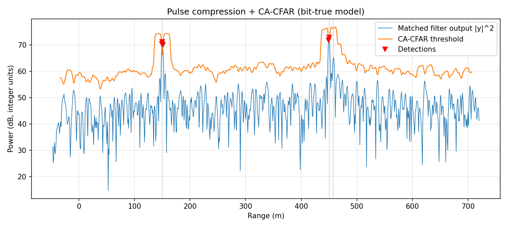
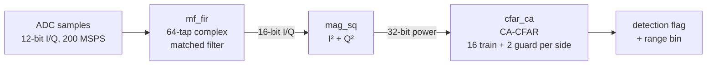

# FPGA Radar Signal Processor (VHDL)

[](https://github.com/alberto-hdz/radar-fpga-dsp/actions/workflows/sim.yml)


A streaming radar range-processing chain in VHDL: LFM pulse compression, magnitude detection, and cell-averaging CFAR (CA-CFAR) detection at one sample per clock. Every block is checked bit for bit against a Python golden model, the full regression runs in CI on every push, and the design meets timing at 200 MHz on an AMD Artix-7.

## Results

| | |
|---|---|
| **Target** | AMD Artix-7 XC7A200T-1 (FBG484), Vivado 2024.2 |
| **Throughput** | 200 MHz clock, one complex sample per clock (200 MSPS) |
| **Timing** | WNS +0.137 ns, WHS +0.067 ns, 0 failing endpoints (Fmax ≈ 205 MHz) |
| **Resources** | 4,300 LUTs (3.2%), 4,780 FFs (1.8%), 116 DSP48E1 (15.7%), 0 BRAM |
| **Verification** | 4 self-checking testbenches, 2048/2048 outputs bit-exact against the Python model |



*Matched filter output for one pulse with three targets (dotted lines). The targets at 150 m and 450 m are detected. The weak target 7.5 m behind the strong one sits inside its training window, which raises the threshold and hides it. That's CFAR masking, and I left it in the test scene on purpose.*

## Architecture



Every block uses AXI4-Stream style `tvalid` / `tlast` handshakes. `tlast` marks the last sample of each pulse's receive window.

| Parameter | Value |
|---|---|
| Sample rate | 200 MSPS complex baseband |
| Waveform | LFM chirp, 50 MHz bandwidth, 64 samples (0.32 µs), time-bandwidth product 16 |
| Range resolution / bin size | 3 m / 0.75 m |
| Receive window | 1024 range bins (768 m) |
| Input and coefficient width | 12-bit signed |
| Matched filter output | 31-bit accumulator, shifted right by 15 to 16 bits |
| CFAR | 16 training + 2 guard cells per side, Pfa = 10⁻⁶, K = 0.540 (35385 in Q0.16) |

## Design decisions

- **Transposed-form FIR.** Each input sample is multiplied by all 64 taps at once and the partial sums move down a register chain, so the critical path is one multiply or one add no matter how many taps there are.
- **No overflow by construction.** The worst case is 64 × 2 × 2047² < 2³⁰, so the accumulator fits in 31 bits and the 16-bit output can never overflow. No saturation logic is needed. The trade-off is headroom: this test scene only uses about 13 of the 16 output bits.
- **Valid-gated chain, cleared on `tlast`.** The pipeline stages run every clock and carry a valid bit, but the adder chain only moves on valid samples, so gaps in the input don't corrupt the sums. The chain is cleared on the last sample of each pulse so the previous pulse's tail never leaks into the next one.
- **No backpressure.** `tready` is tied high. An ADC can't be paused, so the chain is built to keep up at one sample per clock instead.
- **CFAR with no divider.** The threshold is α times the mean, which equals (Pfa^(-1/N) − 1) times the sum. So the test is `CUT · 2^16 > K_Q · sum`, with one constant and no division.
- **Running sums.** Each new sample does one add and one subtract per side instead of re-adding 32 cells. The sums always equal what's in the window, so they never need clearing between pulses.
- **Edge cells.** The first and last 18 cells of a pulse don't have a full window, so they're reported as no detection, same as the model. The last 18 come out of a flush counter right after `tlast`. It can't collide with the next pulse, and a simulation-only assertion checks that.

## Verification

The Python model (`model/radar_model.py`) does every stage in integer math exactly the way the hardware does, and writes the inputs and expected outputs for each stage to `vectors/`. `model/gen_coef_pkg.py` writes the VHDL coefficient package from the same numbers, so no constant is ever copied by hand.

| Testbench | Input | Checks |
|---|---|---|
| `tb_mf` | 12-bit I/Q | matched filter output I/Q, `tlast` |
| `tb_mag_sq` | filter output | power, `tlast` |
| `tb_cfar` | power | detection flag, training sum, range bin, `tlast` |
| `tb_top` | 12-bit I/Q | detection flag, range bin, `tlast` (end to end) |

Each testbench sends two pulses back to back (checks the clear on `tlast`) with an idle cycle every 5 samples (checks the valid gating), and fails the run on any mismatch. Outputs are matched by `tvalid`, not by cycle count, so adding pipeline stages never breaks the tests.

To make sure the testbenches actually catch bugs, I broke the design on purpose and checked that they fail. For example, removing the chain clear gives exactly 63 mismatches, the 63-sample tail of one pulse leaking into the next.

One thing this caught in my own verification: the first CFAR testbench only compared the 1-bit detection flags, and it still passed with a broken running sum because no decision happened to flip. I added a debug port that carries the training sum out to the testbench (left open at the top level, so synthesis removes it). The same bug now fails with 1,976 mismatches.

GitHub Actions runs `make test` on every push. It also checks that the committed vectors still match what the model generates.

## Timing closure

The first build missed 200 MHz by 2.1 ns. Instead of guessing, I dumped every failing path and grouped them by block. There were three separate problems:

| Block | Failing endpoints | Worst slack | Root cause | Fix |
|---|---|---|---|---|
| `cfar_ca` | 37 | −2.116 ns | The 37 × 16 threshold multiply has a constant operand, so synthesis built it from LUTs and carry chains (17 logic levels) | Split the sum into two halves that each fit a DSP48, forced them into DSPs (`use_dsp`) and pipelined them. Recombined exactly as lo + (hi << 18) |
| `mf_fir` | 1,897 | −0.861 ns | The chain clear drove about 3,900 flip-flop resets through a LUT. 88% of the delay was routing | Registered the clear and enable one stage early so they drive the pins directly, and replicated them with `max_fanout` |
| `mag_sq` | 78 | −0.693 ns | Synthesis moved the filter's output register into the next DSP, leaving a 31-bit adder driving the DSP input pins | `keep` on the output register, plus all three DSP48 pipeline registers (input, multiply, product) |

| | First build | Final |
|---|---|---|
| WNS | −2.116 ns | **+0.137 ns** |
| Fmax (approx.) | 140 MHz | **205 MHz** |
| Failing endpoints | 2,012 of 15,733 | **0 of 15,737** |
| LUTs / FFs | 4,357 / 4,491 | 4,300 / 4,780 |
| DSP48E1 | 114 | 116 |

Every fix only added pipeline stages, and the same bit-exact regression passed after each change. Also worth noting: Vivado built about half of the constant-coefficient multipliers from LUTs instead of DSPs, and those met timing on their own, so forcing all of them into DSPs wasn't needed.

## Repository layout

```
model/    Python golden model and coefficient package generator
rtl/      mf_coef_pkg, mf_fir, mag_sq, cfar_ca, radar_top
tb/       self-checking testbenches (one per block, plus end to end)
vectors/  generated test vectors (inputs and expected outputs)
syn/      timing constraint, Vivado build and timing analysis scripts
docs/     plots
```

## Running it

Simulation needs GHDL (tested with 1.0 on Ubuntu 22.04), Python 3.10 or newer, and GNU Make:

```bash
pip install -r requirements.txt
make test      # regenerate the vectors and run all four testbenches
```

Synthesis and implementation need Vivado 2024.2 (no bitstream is generated):

```bash
cd syn
vivado -mode batch -nojournal -source build.tcl
```

Reports go to `syn/out/` (`timing.rpt`, `util.rpt`, `util_hier.rpt`). `analyze.tcl` reopens the routed design and lists every failing path.

## Limitations and next steps

- Simulation and implementation only. It hasn't been run on a board yet.
- Single clock domain. A real ADC runs on its own clock and would need an async FIFO (clock domain crossing) in front of the chain.
- Range only. The next step is a corner-turn memory and a Doppler FFT for a range-Doppler map.
- CA-CFAR masks weak targets next to strong ones (visible in the plot). OS-CFAR or GO/SO-CFAR would handle that better.
- Each target triggers about 3 adjacent detections. A peak-picking stage after the CFAR would report one detection per target.

## License

MIT. See [LICENSE](LICENSE).
